<div align="center">

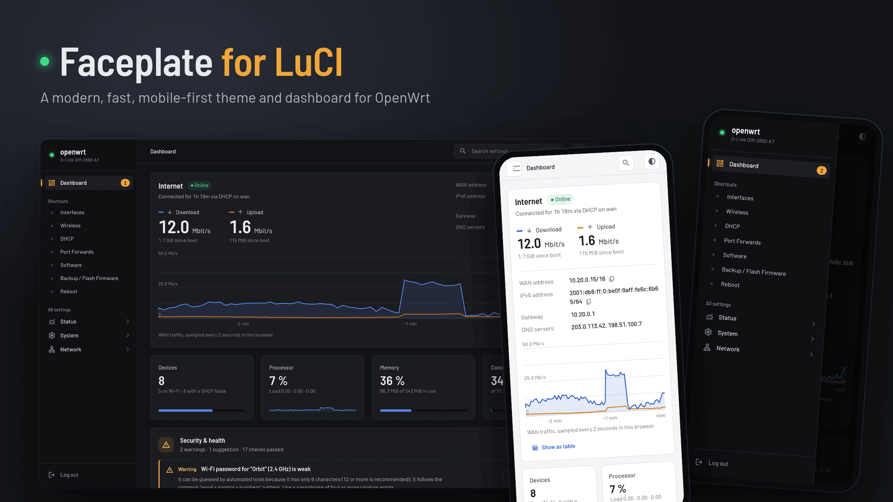

# Faceplate

**Make your OpenWrt router feel like it shipped this decade.**

A modern theme and live dashboard for LuCI. It fits on a 16 MB router and needs no build toolchain to install.


**[▶ Live demo](https://rammanokar.github.io/luci-theme-faceplate/demo/)** · [Project page](https://rammanokar.github.io/luci-theme-faceplate/) · [Screenshots](#screenshots) · [Features](#features) · [Install](#install) · [Uninstall](#uninstall) · [FAQ](#faq)

</div>

---

> **Try it before you install:** the [live demo](https://rammanokar.github.io/luci-theme-faceplate/demo/) runs the real theme in your browser on mock data.

## Why Faceplate?

Stock LuCI is powerful but dense. To find out what's on your network you have to open five pages, and fixing anything usually means a forum search first. Faceplate keeps every LuCI page working and adds:

- **A dashboard that answers the questions you actually have.** Is the internet up? What's using bandwidth? Who's connected? Is anything wrong?
- **A security check that explains its findings.** It flags weak Wi-Fi passwords, risky port forwards and admin services exposed to the internet, and each finding links to the page where you fix it.
- **Search for every page and setting.** Press <kbd>Ctrl</kbd> <kbd>K</kbd>, type "port", and press <kbd>Enter</kbd>.
- **A layout built for phones.** Most router tweaks happen from the couch, so the dashboard and menus work at phone width.

It's a theme, not a fork, so all your packages and their LuCI apps keep working.

## Screenshots

> All screenshots use mock data: made-up device names, documentation IP ranges and randomised MACs.

### Dashboard: dark and light

<table>
<tr>
<td width="50%">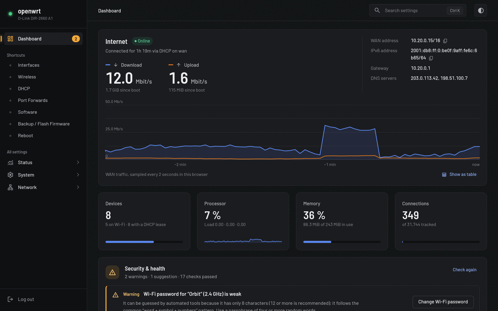</td>
<td width="50%">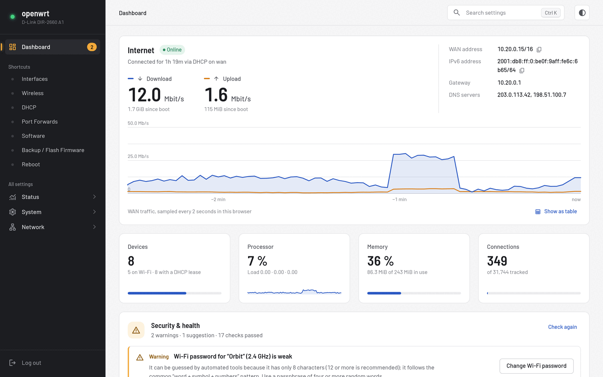</td>
</tr>
</table>

The page opens with live WAN throughput, your public addresses (one click to copy), and tiles for devices, CPU, memory and connection-table usage. Below them is the **Security & health** report.

### Connected devices and Wi-Fi channel analysis

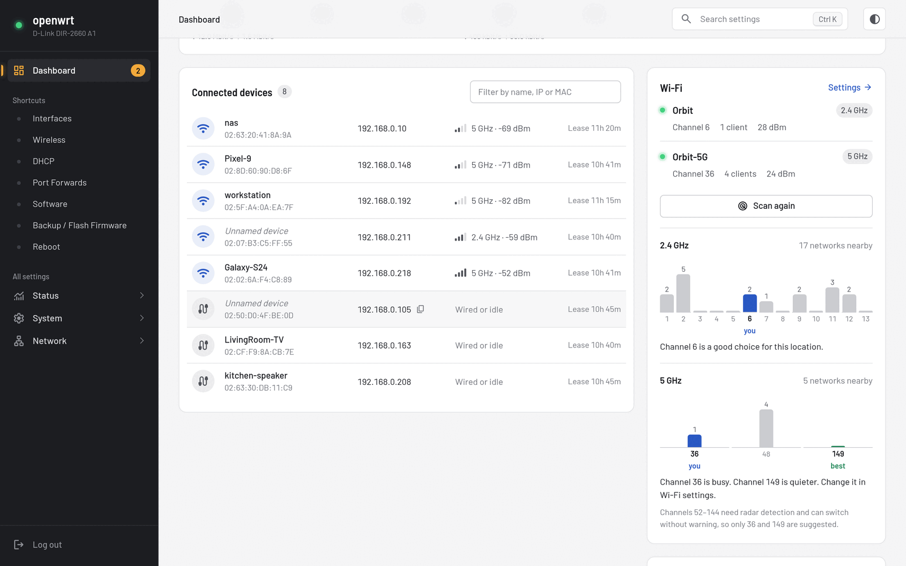

Every client is listed with its name, IP, MAC, band, signal strength and lease time, and you can filter the list. **Check for interference** scans nearby networks, draws how crowded each channel is, and recommends a quieter one. It skips DFS channels, which can switch without warning.

### Search everything

<table>
<tr>
<td width="70%">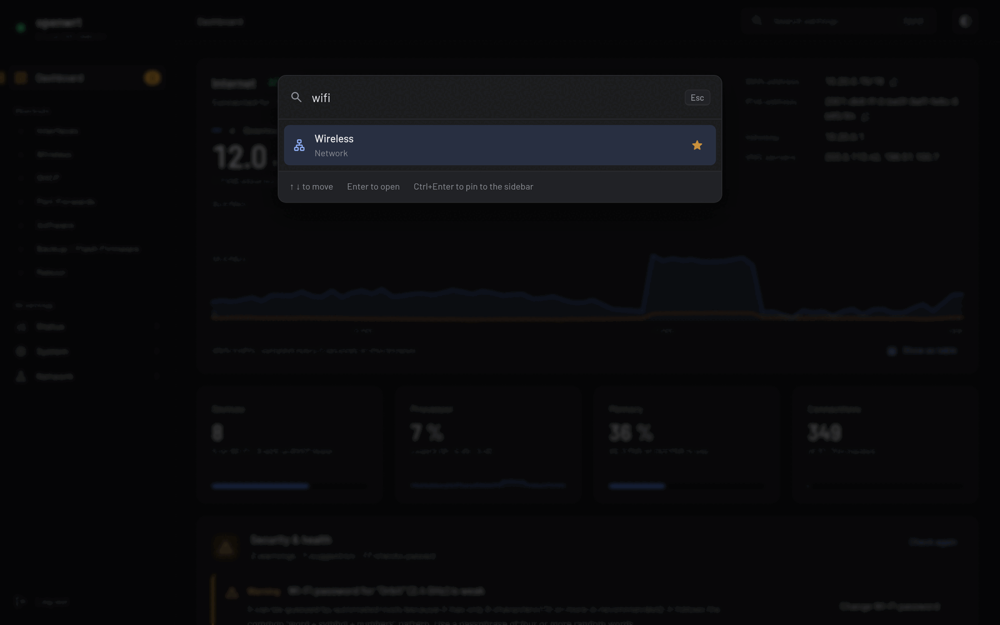</td>
<td width="30%">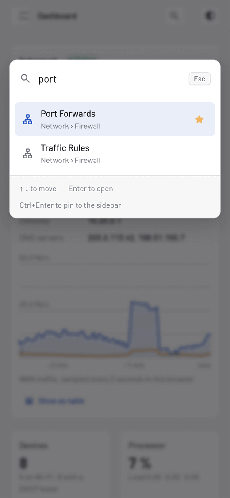</td>
</tr>
</table>

Press <kbd>Ctrl</kbd> <kbd>K</kbd> or <kbd>/</kbd> anywhere. Search understands everyday words: "wifi password", "port forward" and "factory reset" all find the right page. Press <kbd>Ctrl</kbd> <kbd>Enter</kbd> to pin a result to the sidebar.

### On your phone

<table>
<tr>
<td align="center">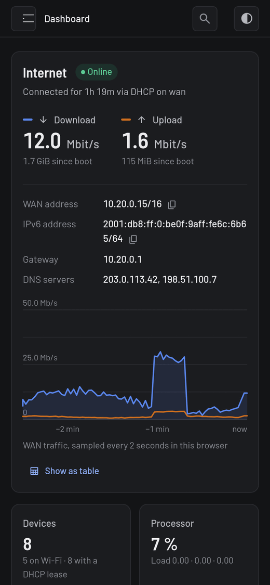<br><sub>Dashboard, dark</sub></td>
<td align="center">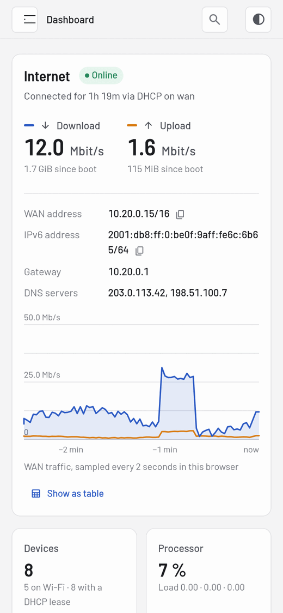<br><sub>Dashboard, light</sub></td>
<td align="center">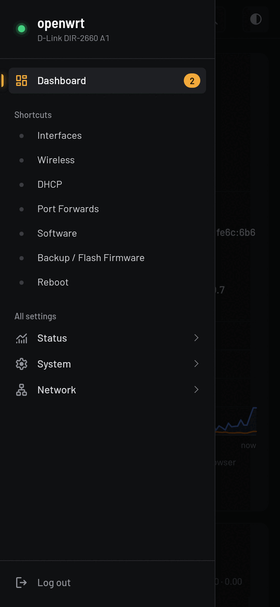<br><sub>Navigation drawer</sub></td>
<td align="center">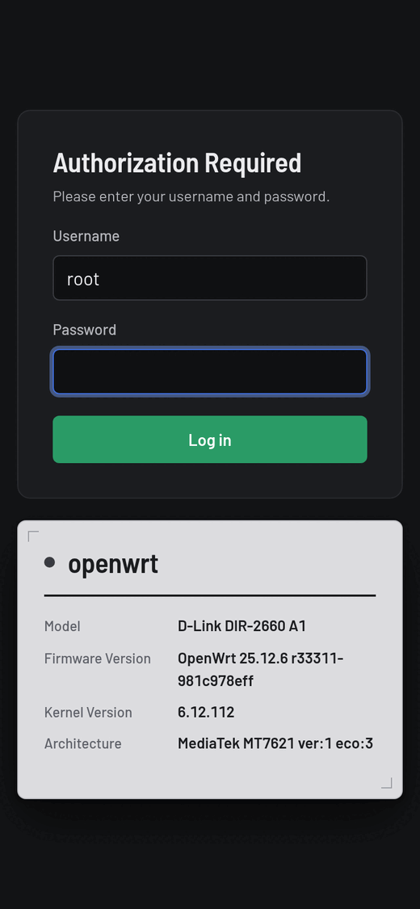<br><sub>Login</sub></td>
</tr>
</table>

### A login page styled like the router's own label

<table>
<tr>
<td width="50%">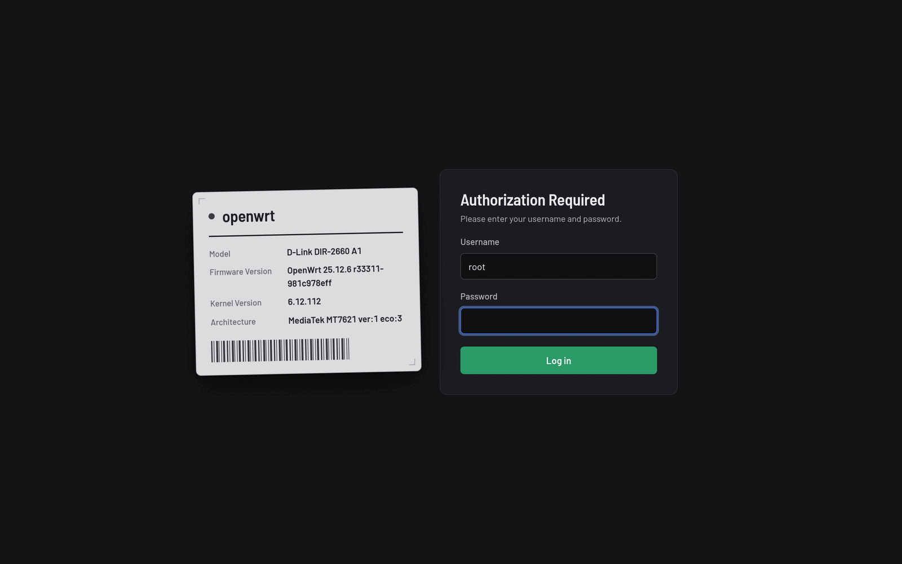</td>
<td width="50%">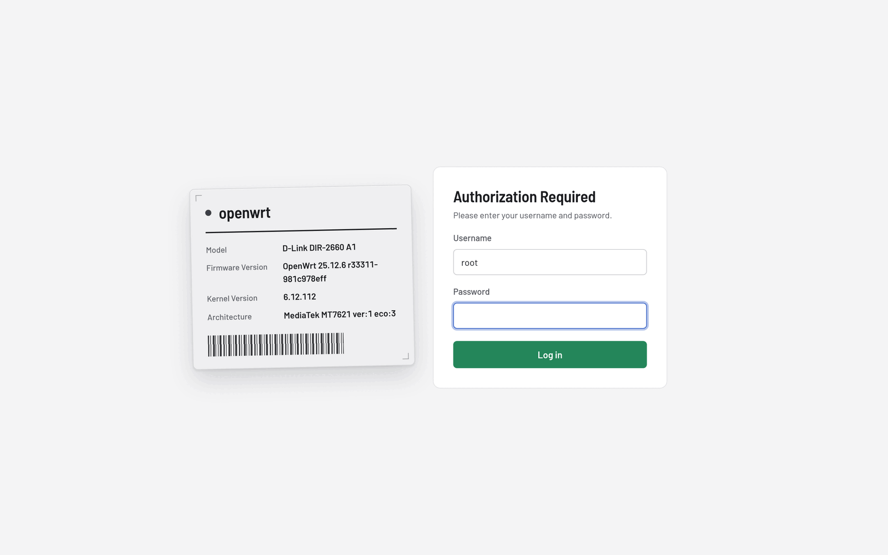</td>
</tr>
</table>

The login page looks like the sticker on the bottom of your router, with the hostname, model, firmware and kernel, so you can tell which box you're logging into.

### Live traffic graph

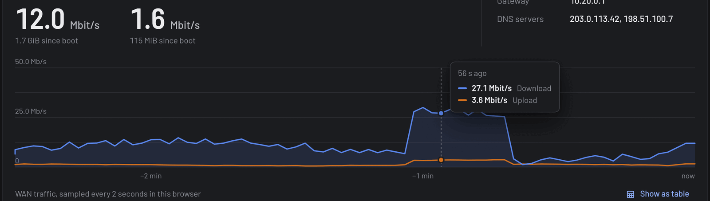

Hover the graph for exact numbers, or click **Show as table** for an accessible view of the data. History is kept in your browser, so the router doesn't do any extra work to record it.

## Features

| | |
|---|---|
| 🏠 **Dashboard** | Internet status, live up/down rate, WAN/IPv6/gateway/DNS, devices, CPU sparkline, memory, conntrack usage |
| 🛡️ **Security & health check** | Weak or reused passwords, Wi-Fi encryption, risky port forwards, SSH/web interface exposed to WAN, HTTPS redirect, NTP, DNS rebind protection, storage and memory pressure, weak client signals |
| 📶 **Wi-Fi insights** | Per-radio status, client counts, TX power, nearby networks per channel, a recommended channel |
| 🔌 **Port view** | Front-panel style port diagram showing link speed and live traffic |
| 🔎 **Command palette** | <kbd>Ctrl</kbd> <kbd>K</kbd> fuzzy search across every page and tab, with recent pages listed first |
| ⭐ **Pinned shortcuts** | Keep the pages you use most in the sidebar |
| 🌗 **Theme switch** | Auto, light or dark, remembered per browser |
| 📱 **Responsive** | Off-canvas drawer, touch-sized controls, no horizontal scrolling |
| ♿ **Accessible** | Keyboard navigation, focus rings, ARIA roles, table view for charts |
| 🪶 **Tiny** | About 255 KiB installed. Icons (Material Symbols) are inlined at build time. Barlow fonts are self-hosted, so no CDN calls |
| 🧩 **Works with everything** | All stock and third-party LuCI pages are restyled, nothing is replaced |

### Privacy and safety

- The security check runs **on the router** as an rpcd plugin. Password hashes and Wi-Fi keys never leave it. The browser only receives the findings.
- The theme makes **no external requests**. There are no fonts from Google, no analytics and no CDN.
- Read-only. The dashboard never changes your configuration. "Fix" buttons just take you to the right LuCI page.

## Install

**Requirements:** OpenWrt **25.12** or later with LuCI (ucode templates), SSH access to the router, and `python3` plus Node.js (`npx`) on your computer for the build step.

```sh
git clone https://github.com/rammanokar/luci-theme-faceplate.git faceplate
cd faceplate/luci-theme-faceplate
./install.sh                 # defaults to root@192.168.0.1
./install.sh root@10.0.0.1   # or point it at your router
```

The script:

1. builds `dist/` by inlining the icons into the stylesheet
2. copies the files to the router over SSH
3. restarts `rpcd` and **health-checks the audit plugin**, removing it if anything misbehaves so LuCI stays reachable
4. remembers your current theme, then makes Faceplate the default

Then open your router in a browser. If you were already logged in, **log out and back in once** so your session picks up the new dashboard permissions.

## Uninstall

```sh
./uninstall.sh               # or ./uninstall.sh root@10.0.0.1
```

This restores the theme you had before (or Bootstrap) and removes every Faceplate file.

## FAQ

<details>
<summary><b>Will it break my other LuCI apps?</b></summary>

No. Faceplate is a theme: it supplies the header, footer and login templates and a stylesheet. Every LuCI page, including third-party apps, renders as usual with the new styling.
</details>

<details>
<summary><b>Does it slow down my router?</b></summary>

The dashboard uses the same ubus calls LuCI's own status page uses, and traffic history lives in your browser. The security check runs only when the dashboard opens or you click <b>Check again</b>.
</details>

<details>
<summary><b>Which routers are supported?</b></summary>

Anything running OpenWrt 25.12+ with LuCI. It was developed on a MediaTek MT7621 router with 256 MB RAM and a 23 MB overlay, so space shouldn't be a problem.
</details>

<details>
<summary><b>Can I switch back to the stock theme temporarily?</b></summary>

Yes. Go to <b>System → System → Language and Style</b> and pick another theme, or run <code>./uninstall.sh</code>.
</details>

## Project layout

```
luci-theme-faceplate/
├── root/                 # source files, mirrored onto the router's filesystem
│   ├── usr/share/ucode/luci/template/themes/faceplate/   # header, footer, login
│   ├── usr/share/rpcd/ucode/faceplate                    # security & health audit
│   └── www/luci-static/
│       ├── faceplate/cascade.css                         # the whole design system
│       └── resources/{menu-faceplate.js, view/faceplate/dashboard.js}
├── assets/icons/         # Material Symbols (inlined at build time)
├── tools/build.py        # builds dist/
├── install.sh / uninstall.sh
site/                     # GitHub Pages: landing page + live demo (mock data)
└── build.py              # python3 site/build.py → _site/
```

## Contributing

Issues and pull requests are welcome, especially screenshots from other routers, translations, and new security checks. If you change anything in `root/www`, bump `ver` in `header.ut` so browsers fetch the new assets.

## License

Apache License 2.0. Icons are [Material Symbols](https://fonts.google.com/icons) (Apache 2.0). The Barlow font is under the SIL Open Font License; see `fonts/OFL.txt`.

<div align="center">
<sub>If Faceplate made your router a little nicer to use, a ⭐ helps others find it.</sub>
</div>
